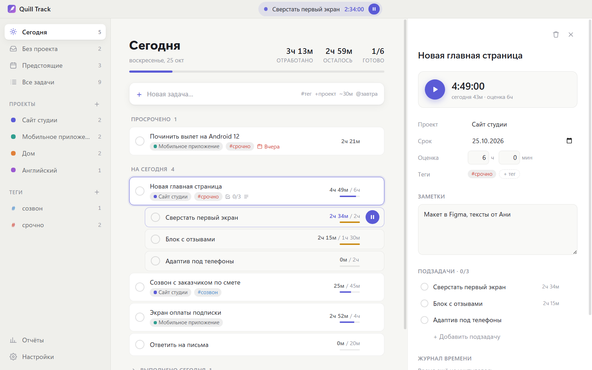
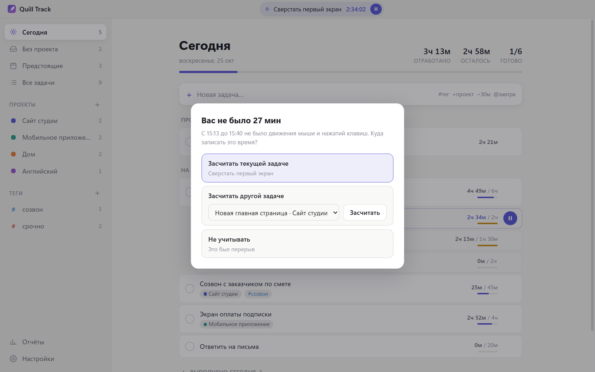
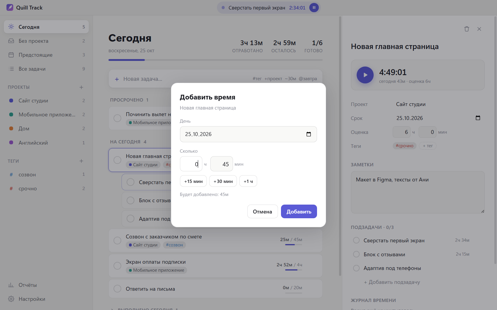
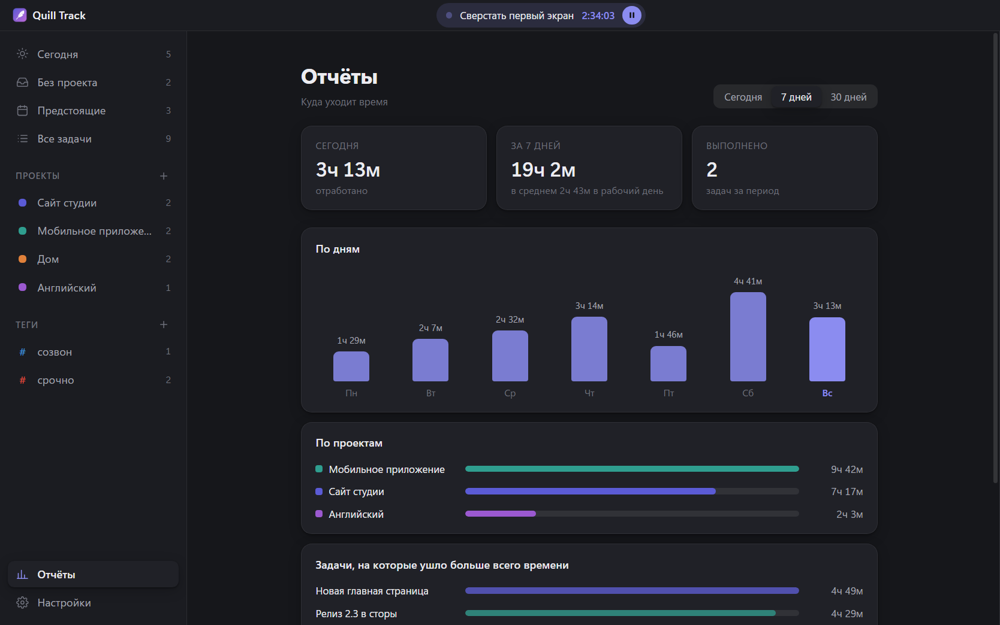
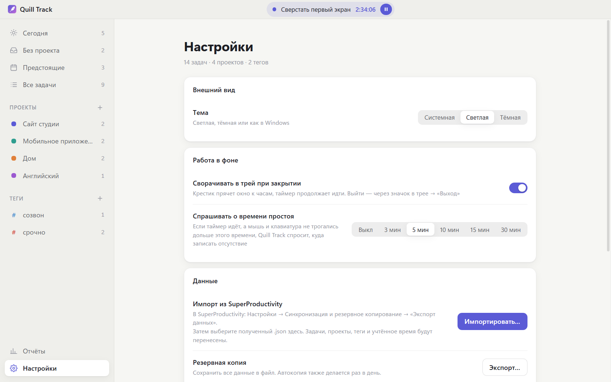

# Quill Track

> **Quill Track** is a calm, minimal task manager with a built-in time tracker for Windows – a lightweight alternative to SuperProductivity. Tasks, subtasks, projects and tags, a one-click timer that keeps running in the tray, idle detection, and simple reports. Data stays on your computer. The interface is in Russian.

Quill Track – лёгкий и минималистичный менеджер задач со встроенным учётом времени. Данные хранятся только у вас на компьютере.



## Возможности

- **Задачи и подзадачи**, проекты, теги, сроки, заметки. Быстрое добавление одной строкой: `Позвонить в банк #срочно +Дом ~30м @завтра`.
- **Таймер в один клик.** Время записывается по дням – видно, сколько ушло сегодня и всего, и насколько вы уложились в оценку.
- **Работа из трея.** Крестик прячет окно к часам, таймер продолжает идти. В подсказке значка – текущая задача и время, в меню – «Открыть», «Пауза / Продолжить таймер», «Выход». Можно выключить в Настройках.
- **Запуск вместе с Windows** – сразу свёрнутым в трей, без окна. Включается в Настройках → «Работа в фоне».
- **Окно простоя.** Если таймер идёт, а вы отошли от компьютера (или он уснул), по возвращении Quill Track спросит, куда записать это время: текущей задаче, другой задаче или никуда. Порог – 3–30 минут или выкл.
- **Понятный ввод времени:** отдельные поля «часы» и «минуты» для оценки, журнала и ручного добавления, плюс быстрые кнопки +15 мин / +30 мин / +1 ч.
- **Отчёты** за сегодня, 7 и 30 дней: по дням, по проектам, по задачам.
- Разделы «Сегодня», «Без проекта», «Предстоящие», «Все задачи»; перетаскивание задач на проекты и теги.
- Светлая и тёмная тема (или как в Windows), горячие клавиши.
- **Выгрузка в папку**: задачи и учтённое время сохраняются в файл в выбранной папке (например, Google Диска), как синхронизация с папкой в SuperProductivity.
- **Приём изменений из папки**: другие программы и ИИ-помощники могут добавлять задачи, переименовывать их и отмечать выполненными, положив JSON-файл в выбранную папку.
- **Резервные копии** (автоматически раз в день).
- **Автообновление:** установленная версия сама скачивает новые версии с GitHub и ставит их при перезапуске.

| | |
|---|---|
|  |  |
|  |  |

## Установка

Скачайте последнюю версию со страницы [Releases](../../releases):

- **`QuillTrack-Setup-x.y.z.exe`** – установщик. Ставится только для текущего пользователя, права администратора не нужны. Создаёт ярлыки на Рабочем столе и в меню «Пуск».
- **`QuillTrack-x.y.z-portable.exe`** – переносная версия: один файл, запускается без установки.

Установленная версия проверяет обновления при запуске и раз в 6 часов, скачивает их в фоне и ставит при следующем перезапуске (или сразу – кнопкой «Перезапустить» в Настройках). Переносная версия обновить себя не может: она только сообщит, что вышла новая, и откроет страницу для скачивания. Проверку можно выключить в Настройках → «Обновления».

Windows может предупредить, что приложение от неизвестного издателя (файл не подписан сертификатом). Нажмите «Подробнее» → «Выполнить в любом случае».

Данные хранятся в `%APPDATA%\Quill Track\quill-track-data.json`, рядом – ежедневные копии за последние 14 дней (`backups\`). Установщик и переносная версия используют одну и ту же папку, так что между ними можно переходить.

Раньше приложение называлось **Flow**. Если на компьютере есть данные Flow (`%APPDATA%\flow`), при первом запуске Quill Track скопирует их к себе; старая папка остаётся нетронутой.

## Приём изменений из папки

В **Настройках → Приём изменений из папки** выберите папку. Раз в минуту Quill Track берёт из неё файлы `*.json`, применяет и удаляет. Файл с ошибкой переименовывается в `*.failed.json`, причина – рядом в `*.failed.txt`. Пишите файл сначала под другим именем (например, `.tmp`) и переименовывайте в `.json`, когда он готов.

В файле – одна команда, массив команд или `{ "commands": [...] }`:

```json
[
  { "action": "update",
    "find": { "parent": { "title": "Отчёты" }, "due": "2026-10-26" },
    "set": { "title": "26 октября: всё сделано", "done": true } },
  { "action": "add",
    "task": { "title": "Позвонить клиенту", "project": "Работа", "due": "2026-10-27" } }
]
```

- `find` – как найти ровно одну задачу: `id`, `title`, `titleStartsWith`, `due` (ГГГГ-ММ-ДД), `project` (название), `parent` (такой же `find` для родителя). Если подходит ноль или несколько задач, файл не применяется.
- `set` – что поменять: `title`, `notes`, `appendNotes` (дописать к заметке), `due`, `done`.
- `add` – новая задача: `title`, `notes`, `due`, `done`, `project` (название) или `parent` (`find` родителя).

## Горячие клавиши

| Клавиша | Действие |
|---|---|
| `N` | новая задача |
| `↑` `↓`, `Enter` | выбрать и открыть задачу |
| `Пробел` | старт / пауза таймера |
| `D` | выполнено |
| `T` | на сегодня |
| `Del` | удалить (можно вернуть) |
| `1`–`4` | разделы |
| `Esc` | закрыть панель |

## Сборка из исходников

Нужен [Node.js](https://nodejs.org/) 20 или новее.

```bash
git clone https://github.com/worldruschel/quill-track.git
cd quill-track
npm install
npm start
```

Собрать установщик и переносную версию (появятся в `dist/`):

```bash
npm run dist
```

> На Windows сборщик NSIS не справляется с очень длинными путями (ограничение `MAX_PATH`). Если сборка падает с ошибкой пути, скопируйте проект в короткую папку, например `C:\qt`, и соберите там.

### Выпуск новой версии

1. Поднимите `version` в `package.json` и закоммитьте.
2. Соберите и опубликуйте релиз на GitHub (нужен токен с правом `repo` в переменной `GH_TOKEN`):

   ```bash
   npx electron-builder --win --publish always
   ```

   Вместе с exe в релиз попадает `latest.yml` – по нему установленные копии узнают о новой версии.
3. Поставьте метку: `git tag v0.2.0 && git push --tags`.

Чтобы экспериментировать, не трогая свои настоящие задачи, запустите приложение с отдельной папкой данных:

```powershell
$env:QUILL_DATA_DIR = "C:\temp\quill-test"; npm start
```

Устройство проекта – без сборщика и фреймворков:

| Файл | Что внутри |
|---|---|
| `main.js` | окно, трей, определение простоя, сохранение данных и резервные копии |
| `preload.js` | мост `window.flow` между окном и main-процессом |
| `src/app.js` | вся логика и отрисовка интерфейса |
| `src/styles.css` | стили и цветовые токены светлой и тёмной темы |
| `src/folder-sync.js` | файл для выгрузки в папку |
| `src/inbox.js` | приём изменений из папки |

Интерфейс можно открыть и в обычном браузере (`src/index.html` через любой локальный веб-сервер) – тогда данные хранятся в `localStorage`, а трей и простой недоступны.

## Лицензия

[MIT](LICENSE) © 2026 Evgenii Svalov
